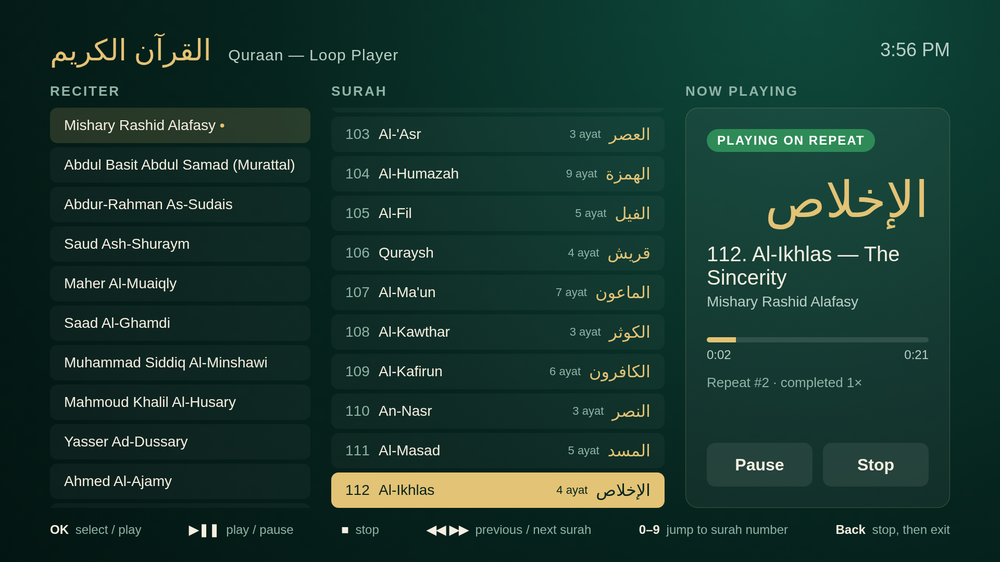

# Quraan — Samsung TV loop player

A Samsung Smart TV (Tizen) app that plays a Quran recitation **on repeat until you stop it**.
Pick a reciter and a surah with the remote; the surah loops forever (and reconnects on its own
if the network drops) until you press **Stop** or **Back**.



## Remote controls

| Key | Action |
| --- | --- |
| Arrows / OK | Move between Reciter, Surah and the Play/Stop buttons; OK selects or plays |
| Play/Pause (▶❚❚) | Play / pause |
| Stop (■) | Stop |
| ⏮ / ⏭ (or ◀◀ / ▶▶) | Previous / next surah (keeps looping) |
| 0–9 | Type a surah number (e.g. `3` `6` for Ya-Sin); it starts after 1.5 s |
| Back | Stop playback; press again to exit the app |

The last reciter and surah are remembered. The TV screensaver is disabled while audio is playing.

## How it works

- Plain HTML/CSS/ES5 JavaScript Tizen web app (`config.xml`, `index.html`, `js/`, `css/`), no build step.
- `js/player.js` — `LoopPlayer`: `<audio loop>` plus a manual restart on `ended` (some TV media
  pipelines ignore `loop`), loop counting, and retry with backoff on errors/stalls.
- `js/app.js` — UI, focus navigation, Tizen remote key registration, screensaver control.
- `js/data.js` — 14 reciters and the 114 surahs. Audio streams from
  `https://download.quranicaudio.com/quran/<reciter>/<NNN>.mp3`, so the TV needs internet access.
  To add a reciter, append an entry with its `relative_path` from `https://quranicaudio.com/api/qaris`.

No API keys or secrets are needed.

## Run in a desktop browser

```bash
python3 -m http.server 8080
# open http://localhost:8080 — arrows/Enter navigate, Space = play/pause, Esc/Backspace = Back
```

Automated smoke test (drives the app with TV key codes over Chrome DevTools Protocol):

```bash
pip install playwright
CDP_URL=http://localhost:9222 python3 tests/smoke.py   # Chrome started with --remote-debugging-port=9222
```

## Install on a Samsung TV

1. Install [Tizen Studio](https://developer.tizen.org/development/tizen-studio/download) with the
   **Samsung TV Extensions** and **Samsung Certificate Extension** (Package Manager → Extension SDK).
2. On the TV: open **Apps**, press `1` `2` `3` `4` `5` on the remote, turn **Developer mode** on and
   enter your computer's IP address, then restart the TV.
3. In Tizen Studio open **Tools → Certificate Manager**, create a **Samsung** certificate profile
   (sign in with a Samsung account; add the TV's DUID when asked — Device Manager shows it once
   connected). Name it e.g. `quraan`.
4. Connect and install:

   ```bash
   export PATH="$HOME/tizen-studio/tools:$HOME/tizen-studio/tools/ide/bin:$PATH"
   sdb connect <TV_IP>
   TIZEN_PROFILE=quraan ./scripts/package.sh          # -> dist/Quraan.wgt
   tizen install -n dist/Quraan.wgt -t <TV_NAME>       # TV_NAME from `sdb devices`
   tizen run -p QrnLoopTv1.Quraan -t <TV_NAME>
   ```

A package signed with a plain Tizen (non-Samsung) certificate installs on the Tizen TV emulator but
is rejected by retail Samsung TVs. Publishing to the Samsung TV app store is done through
[Samsung Apps TV Seller Office](https://seller.samsungapps.com/tv).
